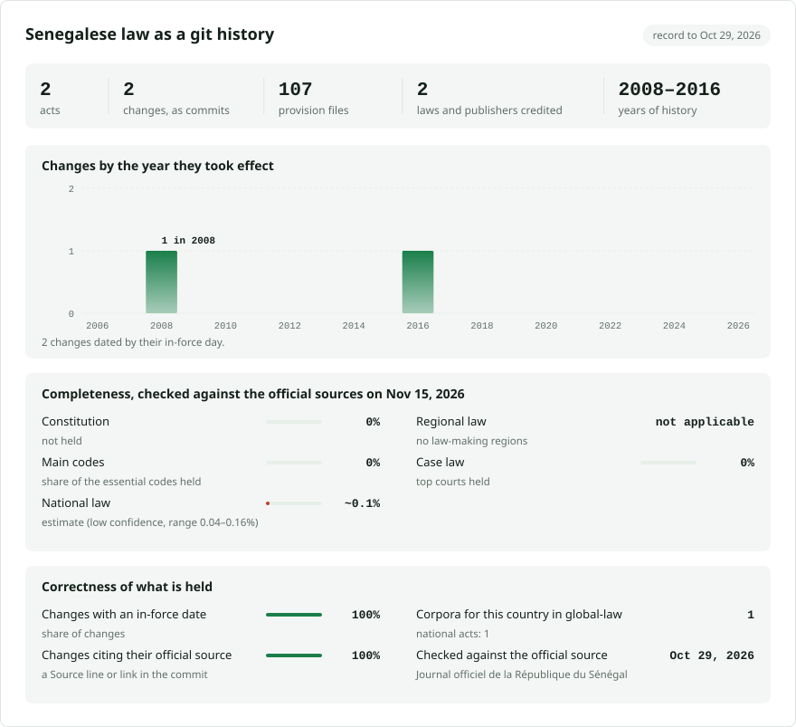

# Senegal: law history in git

[Français](README.md) · **English**

<picture>
<source media="(prefers-color-scheme: dark)" srcset="data/effort-dark.svg">

</picture>

The law of Senegal as a git history: one file per article, each version committed on the day it took effect, and the law that made each change as the commit's author. `git blame` names the law behind every paragraph; `git log` lists every change to an article; picking a date gives the text in force that day.

Part of [lexifina/global-law](https://github.com/lexifina/global-law), one git history for every country's law: this is Senegal's national law, which global-law reads at `senegal/national/acts/`.

**What is in it now:** 10027 texts as published, in 64915 article files, in force from 1981 to 2018: the Constitution of 22 January 2001 as enacted (`constitution/`), 9 codes as enacted (`codes/`), 467 laws (including the constitutional laws of 2003 to 2016), 4946 decrees, 4198 arrêtés and 404 other texts (community acts, treaties, ministerial decisions), mostly from the Journal officiel's web edition (2001-2018, the archived jo.gouv.sn site), plus the two laws of the first build (`donnees-personnelles/`, `conseil-constitutionnel/`). The Constitution's revisions are in `lois/` but not yet applied to its articles; texts published only as page images are not here. Details and what was left out: [REPRODUCE.md](REPRODUCE.md); the folder layout: [STRUCTURE.md](STRUCTURE.md).

Each act is a folder named for its subject, one file per article: `donnees-personnelles/` is Loi n° 2008-12 (`art-033.md` is Article 33, when processing personal data is lawful) and `conseil-constitutionnel/` is Loi organique n° 2016-23. Each folder's `README.md` lists every article.

The text is in French, the official language of Senegal, as the Journal officiel and the Conseil constitutionnel print it. An English translation is not part of this record.

## Questions as git commands

| Question | Command |
| --- | --- |
| Every change to Article 33 of the data protection law | `git log -p --word-diff -- donnees-personnelles/art-033.md` |
| Which law wrote each line of Article 33? | `git blame donnees-personnelles/art-033.md` |
| Every version of Article 33, with the day each took effect | `git log --format="%h %(trailers:key=In-force,valueonly,separator=) %an" -- donnees-personnelles/art-033.md` |
| Article 33 as in force on 1 January 2020 | `python tools/en_vigueur_au.py 2020-01-01 donnees-personnelles 33` |

**Outside git**, we also host this record publicly, for free:

- **[Ask Claude about Senegalese law](https://global-law.lexifina.com/v1/try_claude?country=senegal)**: opens Claude with a first question ready.
- **[Ask ChatGPT](https://global-law.lexifina.com/v1/try_chatgpt?country=senegal)**: the same question in ChatGPT.
- **[Search Senegalese law on our site](https://lexifina.com/law?country=senegal&q=donn%C3%A9es+personnelles)**: a search for "données personnelles" (personal data), with each provision's text and its versions, no account needed.
- **[Developer REST API](https://global-law.lexifina.com/v1/search_law?query=donn%C3%A9es+personnelles&jurisdiction=senegal)**: the same search as JSON, with no key. See the [documentation here](https://lexifina.com/api/global-law).

Both assistants read the record through the free Global law connector (MCP, `https://global-law.lexifina.com/mcp`); the first time, the chat gives you the link that adds it. Ask in French or in English.

**Host it yourself easily.** All it takes is git and Python, and the tools run on your machine:

```sh
git clone --depth 1 https://github.com/lexifina/global-law && cd global-law
python3 tools/countries.py add senegal/national/acts
python3 tools/law.py show 2026-01-01 senegal/national/acts/donnees-personnelles/art-033.md
```

Opened in Claude Code, Cursor, VS Code or Codex, the clone also starts a local MCP server with the same tools ([MCP.md](https://github.com/lexifina/global-law/blob/main/MCP.md)).

## Dates

Each commit is dated at noon, Africa/Dakar (UTC), on the day the version took effect, and carries it in its `In-force:` trailer (the promulgation day is in `Enacted:`, the Journal officiel's in `Published:`):

- both acts follow Loi n° 70-14 du 6 février 1970, art. 2: a law becomes executory in Dakar on the third day after the Journal officiel that prints it is deposited with the Secrétariat général de la Présidence, one day later for each Sunday or public holiday before then;
- the deposit receipts were not found, so each issue's own date stands in: Loi n° 2008-12 (JO n° 6406, Saturday 3 May 2008) took effect on 7 May 2008, and Loi organique n° 2016-23 (JORS numéro spécial 6946, Friday 15 July 2016) on 19 July 2016;
- laws published from 20 March 2021 take effect "un jour franc" after publication (Loi n° 2021-21 du 2 mars 2021, art. 10); no act here falls under that rule yet.

Each act's first commit is the act as enacted, credited to the act itself (`Loi n° 2008-12`, `Loi organique n° 2016-23`). The committer is always Lexifina.

## How it is checked

- `tools/check_repo.py` reads every version back from git on the day it took effect and on the day before, and both must match the corpus the history was built from; it also checks that every commit's trailers parse, that there are no merge commits and that no commit is dated in the future. Results are in [`REPRODUCE.md`](REPRODUCE.md).
- `tools/build.py` writes the history from that corpus in one pass, and the same corpus always gives the same commit hashes; [`data/corpus.sha256`](data/corpus.sha256) gives the corpus's hash. No second build has been compared yet.
- Loi n° 2008-12 was compared article by article with the copy the Commission de Protection des Données Personnelles (CDP) publishes: all 78 articles agree apart from spelling, two line-end splits and the last sentence of art. 78, which only the Journal officiel prints; two slips of the Journal officiel's web edition (arts. 16 and 57) are corrected from it, as REPRODUCE.md lists.
- No amending law was found for either act; Loi n° 18/2026, which would have replaced the Conseil constitutionnel with a Cour constitutionnelle, was declared unconstitutional (décision n° 6/C/2026 du 9 juillet 2026) and never took effect.
- [vulnerabilities/](vulnerabilities/README.en.md): possible drafting mistakes in this law, found by global-law's detectors and checked by hand. Not run yet.

## What it does not show

- **The Constitution of 2001.** Its only consolidation, the Conseil constitutionnel's (current to Loi constitutionnelle 2018-14), mixes about 100 editorial notes and « » change markers into the text, with no clean copy to check against; a "Loi n° 11/2024 portant révision de la Constitution" exists only as an image scan, and its status is not settled.
- **The codes and other laws.** The Journal officiel's site (jo.gouv.sn) has been offline since about 2019, and no official site publishes dated versions of Senegalese law. The Code pénal (Loi 65-60) is available only as image scans, and this record does not transcribe images.
- **Headings and formulas.** Chapter and section headings, the exposé des motifs, the enacting and executory formulas and the signatures are left out; each file starts with "# Article N".
- **Deposit days.** The in-force days rest on each issue's printed date (see Dates).

## Sources

| Source | Kind | Past versions | Notes |
| --- | --- | --- | --- |
| [Journal officiel de la République du Sénégal](https://web.archive.org/web/20150609214903/http://www.jo.gouv.sn/spip.php?article6663) (Internet Archive copy) | Official gazette, web edition (about 2001 to 2018) | as published | Loi n° 2008-12 (JO n° 6406, 3 May 2008) |
| [Conseil constitutionnel](https://conseilconstitutionnel.sn/la-loi-organique/) | The Conseil's own page for its organic law | no, the text as promulgated | Loi organique n° 2016-23 (JORS NS 6946, 15 July 2016) |
| [Commission de Protection des Données Personnelles](https://www.cdp.sn) (Internet Archive copy) | Data protection authority | no | Checking Loi n° 2008-12, and that it is still the law |
| [Vie Publique Sénégal](https://www.vie-publique.sn) | Civic publisher of Journal officiel issues | no | The in-force rules (Loi n° 70-14, Loi n° 2021-21) and the search for later laws; no legal text here comes from it |

## Licence

See [`LICENSE`](LICENSE). The texts are official legal texts of the Republic of Senegal, from the Journal officiel and the Conseil constitutionnel; neither publishes a licence for them, their copyright status is not confirmed, and they are reproduced with that attribution. The history, commit messages, tables and tools are CC0 1.0.

No AI model wrote, translated or corrected legal text, and none runs when the history is built; the scripts were written by an AI model (see [`REPRODUCE.md`](REPRODUCE.md)).

## Visualisations

- [visualisations/](visualisations/README.en.md): charts drawn from this repository. Not drawn yet.

## More

From [lexifina/global-law](https://github.com/lexifina/global-law):

- [FEATURES.md](https://github.com/lexifina/global-law/blob/main/FEATURES.md): every feature, and what every corpus must support (`git blame`, `law.py`, the MCP tools)
- [FAQ.md](https://github.com/lexifina/global-law/blob/main/FAQ.md): questions and answers · [CONTRIBUTING.md](https://github.com/lexifina/global-law/blob/main/CONTRIBUTING.md): proposing changes · [MCP.md](https://github.com/lexifina/global-law/blob/main/MCP.md): the MCP server · [REPRODUCE.md](https://github.com/lexifina/global-law/blob/main/REPRODUCE.md): how it was built · [CHANGELOG.md](https://github.com/lexifina/global-law/blob/main/CHANGELOG.md)
- [FRESHNESS.md](https://github.com/lexifina/global-law/blob/main/FRESHNESS.md): how current each corpus is · [Monitoring](https://github.com/lexifina/global-law/tree/main/monitoring): whether updates are running · [WATCHING.md](https://github.com/lexifina/global-law/blob/main/WATCHING.md): how each official source is watched for changes
- [performance/](https://github.com/lexifina/global-law/tree/main/performance): how fast the tools are, measured
- [visualisations/](https://github.com/lexifina/global-law/tree/main/visualisations): charts and bridges across the world's law
- [Vulnerabilities](https://github.com/lexifina/global-law/tree/main/vulnerabilities): mistakes in legislation as published
