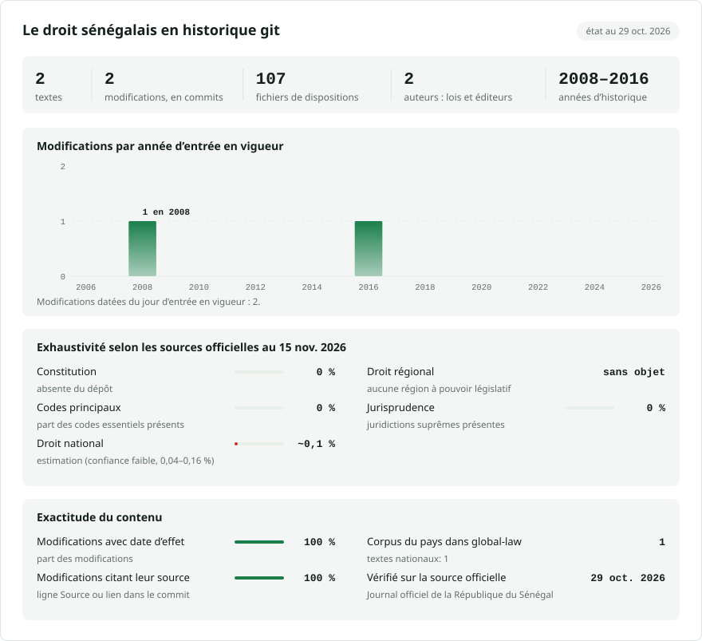

# Sénégal : l’histoire du droit dans git

**Français** · [English](README.en.md)

<picture>
<source media="(prefers-color-scheme: dark)" srcset="data/fr/effort-dark.svg">

</picture>

Le droit du Sénégal sous la forme d’un historique git : un fichier par article, chaque version enregistrée dans un commit à la date de son entrée en vigueur, et la loi auteur de chaque modification comme auteur du commit. `git blame` indique la loi à l’origine de chaque alinéa ; `git log` liste toutes les modifications d’un article ; le choix d’une date donne le texte en vigueur ce jour-là.

Fait partie de [lexifina/global-law](https://github.com/lexifina/global-law), un historique git unique pour le droit de tous les pays : il s’agit ici du droit national du Sénégal, que global-law lit sous `senegal/national/acts/`.

**Contenu actuel :** deux textes, chacun en une version, tels qu’adoptés : la Loi n° 2008-12 du 25 janvier 2008 portant sur la protection des données à caractère personnel (78 articles, en vigueur à compter du 7 mai 2008) et la Loi organique n° 2016-23 du 14 juillet 2016 relative au Conseil constitutionnel (27 articles, en vigueur à compter du 19 juillet 2016). Aucune loi modifiant l’un ou l’autre n’a été trouvée ; une version unique constitue donc tout l’historique de chaque texte. La Constitution et les codes n’y figurent pas encore.

Chaque texte est un dossier nommé d’après son objet, avec un fichier par article : `donnees-personnelles/` est la Loi n° 2008-12 (`art-033.md` est l’article 33, sur les conditions de licéité du traitement des données à caractère personnel) et `conseil-constitutionnel/` la Loi organique n° 2016-23. Le `README.md` de chaque dossier liste tous les articles.

Le texte est en français, langue officielle du Sénégal, tel que l’impriment le Journal officiel et le Conseil constitutionnel. Une traduction anglaise ne fait pas partie de ce corpus.

## Questions sous forme de commandes git

| Question | Commande |
| --- | --- |
| Toutes les modifications de l’article 33 de la loi sur la protection des données | `git log -p --word-diff -- donnees-personnelles/art-033.md` |
| Quelle loi a rédigé chaque ligne de l’article 33 ? | `git blame donnees-personnelles/art-033.md` |
| Toutes les versions de l’article 33, avec la date d’entrée en vigueur de chacune | `git log --format="%h %(trailers:key=In-force,valueonly,separator=) %an" -- donnees-personnelles/art-033.md` |
| L’article 33 tel qu’en vigueur au 1er janvier 2020 | `python tools/en_vigueur_au.py 2020-01-01 donnees-personnelles 33` |

**En dehors de git**, nous hébergeons aussi ce corpus publiquement, gratuitement :

- **[Interroger Claude sur le droit sénégalais](https://global-law.lexifina.com/v1/try_claude?country=senegal)** : ouvre Claude avec une première question prête.
- **[Interroger ChatGPT](https://global-law.lexifina.com/v1/try_chatgpt?country=senegal)** : la même question dans ChatGPT.
- **[Rechercher dans le droit sénégalais sur notre site](https://lexifina.com/law?country=senegal&q=donn%C3%A9es+personnelles)** : une recherche de « données personnelles », avec le texte de chaque disposition et ses versions, sans compte.
- **[API REST pour développeurs](https://global-law.lexifina.com/v1/search_law?query=donn%C3%A9es+personnelles&jurisdiction=senegal)** : la même recherche au format JSON, sans clé. Voir la [documentation ici](https://lexifina.com/api/global-law).

Les deux assistants lisent le corpus au moyen du connecteur gratuit Global law (MCP, `https://global-law.lexifina.com/mcp`) ; la première fois, la conversation vous donne le lien qui l’ajoute. Posez vos questions en français ou en anglais.

**L’héberger vous-même, simplement.** Il suffit de git et de Python, et les outils s’exécutent sur votre machine :

```sh
git clone --depth 1 https://github.com/lexifina/global-law && cd global-law
python3 tools/countries.py add senegal/national/acts
python3 tools/law.py show 2026-01-01 senegal/national/acts/donnees-personnelles/art-033.md
```

Ouvert dans Claude Code, Cursor, VS Code ou Codex, le clone démarre aussi un serveur MCP local doté des mêmes outils ([MCP.md](https://github.com/lexifina/global-law/blob/main/MCP.md)).

## Dates

Chaque commit est daté à midi, heure Africa/Dakar (UTC), du jour où la version est entrée en vigueur, et porte cette date dans son trailer `In-force:` (la date de promulgation figure dans `Enacted:`, celle du Journal officiel dans `Published:`) :

- les deux textes relèvent de la Loi n° 70-14 du 6 février 1970, art. 2 : une loi devient exécutoire à Dakar le troisième jour suivant le dépôt, au Secrétariat général de la Présidence, du Journal officiel qui la publie, ce délai étant prorogé d’un jour pour chaque dimanche ou jour férié qui le précède ;
- les récépissés de dépôt n’ayant pas été trouvés, la date propre de chaque numéro en tient lieu : la Loi n° 2008-12 (JO n° 6406, samedi 3 mai 2008) est entrée en vigueur le 7 mai 2008, et la Loi organique n° 2016-23 (JORS numéro spécial 6946, vendredi 15 juillet 2016) le 19 juillet 2016 ;
- les lois publiées à compter du 20 mars 2021 entrent en vigueur « un jour franc » après leur publication (Loi n° 2021-21 du 2 mars 2021, art. 10) ; aucun texte du présent corpus ne relève encore de cette règle.

Le premier commit de chaque texte est le texte tel qu’adopté, attribué au texte lui-même (`Loi n° 2008-12`, `Loi organique n° 2016-23`). Le committer est toujours Lexifina.

## Méthode de vérification

- `tools/check_repo.py` relit chaque version dans git le jour de son entrée en vigueur et la veille, et les deux doivent correspondre au corpus à partir duquel l’historique a été construit ; il vérifie aussi que les trailers de chaque commit sont analysables, l’absence de commits de fusion et qu’aucun commit n’est daté dans le futur. Les résultats figurent dans [`REPRODUCE.md`](REPRODUCE.md).
- `tools/build.py` écrit l’historique à partir de ce corpus en une seule passe, et un même corpus donne toujours les mêmes empreintes de commit ; [`data/corpus.sha256`](data/corpus.sha256) donne l’empreinte du corpus. Aucune seconde construction n’a encore été comparée.
- La Loi n° 2008-12 a été comparée article par article avec la copie que publie la Commission de Protection des Données Personnelles (CDP) : les 78 articles concordent, hormis l’orthographe, deux coupures de fin de ligne et la dernière phrase de l’art. 78, que seul le Journal officiel imprime ; deux erreurs matérielles de l’édition en ligne du Journal officiel (art. 16 et 57) sont corrigées d’après cette copie, comme l’indique REPRODUCE.md.
- Aucune loi modificative n’a été trouvée pour l’un ou l’autre texte ; la Loi n° 18/2026, qui aurait remplacé le Conseil constitutionnel par une Cour constitutionnelle, a été déclarée contraire à la Constitution (décision n° 6/C/2026 du 9 juillet 2026) et n’est jamais entrée en vigueur.

## Ce qu’il ne montre pas

- **La Constitution de 2001.** Sa seule version consolidée, celle du Conseil constitutionnel (à jour de la Loi constitutionnelle 2018-14), mêle au texte une centaine de notes éditoriales et de marqueurs de modification « », sans copie propre permettant de la vérifier ; une « Loi n° 11/2024 portant révision de la Constitution » n’existe que sous forme de numérisation d’image, et son statut n’est pas établi.
- **Les codes et les autres lois.** Le site du Journal officiel (jo.gouv.sn) est hors ligne depuis 2019 environ, et aucun site officiel ne publie de versions datées du droit sénégalais. Le Code pénal (Loi 65-60) n’est disponible que sous forme de numérisations d’images, et ce corpus ne transcrit pas les images.
- **Les intitulés et les formules.** Les intitulés des chapitres et sections, l’exposé des motifs, les formules de promulgation et exécutoire et les signatures sont omis ; chaque fichier commence par « # Article N ».
- **Les dates de dépôt.** Les dates d’entrée en vigueur reposent sur la date imprimée de chaque numéro (voir Dates).

## Sources

| Source | Nature | Versions antérieures | Remarques |
| --- | --- | --- | --- |
| [Journal officiel de la République du Sénégal](https://web.archive.org/web/20150609214903/http://www.jo.gouv.sn/spip.php?article6663) (copie de l’Internet Archive) | Journal officiel, édition en ligne (2001 à 2018 environ) | tel que publié | Loi n° 2008-12 (JO n° 6406, 3 mai 2008) |
| [Conseil constitutionnel](https://conseilconstitutionnel.sn/la-loi-organique/) | La page du Conseil consacrée à sa loi organique | non, le texte tel que promulgué | Loi organique n° 2016-23 (JORS NS 6946, 15 juillet 2016) |
| [Commission de Protection des Données Personnelles](https://www.cdp.sn) (copie de l’Internet Archive) | Autorité de protection des données | non | Vérification de la Loi n° 2008-12, et du fait qu’elle est toujours en vigueur |
| [Vie Publique Sénégal](https://www.vie-publique.sn) | Éditeur civique de numéros du Journal officiel | non | Les règles d’entrée en vigueur (Loi n° 70-14, Loi n° 2021-21) et la recherche de lois ultérieures ; aucun texte juridique du présent corpus n’en provient |

## Licence

Voir [`LICENSE`](LICENSE). Les textes sont des textes juridiques officiels de la République du Sénégal, issus du Journal officiel et du Conseil constitutionnel ; aucun des deux ne publie de licence pour ces textes, leur statut au regard du droit d’auteur n’est pas confirmé, et ils sont reproduits avec cette mention de source. L’historique, les messages de commit, les tableaux et les outils sont sous licence CC0 1.0.

Aucun modèle d’IA n’a rédigé, traduit ni corrigé de texte juridique, et aucun ne s’exécute lors de la construction de l’historique ; les scripts ont été écrits par un modèle d’IA (voir [`REPRODUCE.md`](REPRODUCE.md)).

Ceci est une traduction de la version anglaise ([README.en.md](README.en.md)) ; en cas de divergence, la version anglaise fait foi.

## En savoir plus

Dans le dépôt [lexifina/global-law](https://github.com/lexifina/global-law) (pages en anglais) :

- [FEATURES.md](https://github.com/lexifina/global-law/blob/main/FEATURES.md): toutes les fonctionnalités et ce que chaque corpus doit prendre en charge (`git blame`, `law.py`, outils MCP)
- [FAQ.md](https://github.com/lexifina/global-law/blob/main/FAQ.md): questions et réponses · [CONTRIBUTING.md](https://github.com/lexifina/global-law/blob/main/CONTRIBUTING.md): proposer une modification · [MCP.md](https://github.com/lexifina/global-law/blob/main/MCP.md): serveur MCP · [REPRODUCE.md](https://github.com/lexifina/global-law/blob/main/REPRODUCE.md): comment il a été construit · [CHANGELOG.md](https://github.com/lexifina/global-law/blob/main/CHANGELOG.md)
- [FRESHNESS.md](https://github.com/lexifina/global-law/blob/main/FRESHNESS.md): à quel point chaque corpus est à jour · [Surveillance](https://github.com/lexifina/global-law/tree/main/monitoring): si les mises à jour fonctionnent · [WATCHING.md](https://github.com/lexifina/global-law/blob/main/WATCHING.md): comment chaque source officielle est surveillée pour repérer les modifications
- [performance/](https://github.com/lexifina/global-law/tree/main/performance): la rapidité des outils, mesurée
- [visualisations/](https://github.com/lexifina/global-law/tree/main/visualisations): graphiques et liens à travers le droit du monde entier
- [Vulnérabilités](https://github.com/lexifina/global-law/tree/main/vulnerabilities): erreurs dans les textes tels qu’ils ont été publiés
